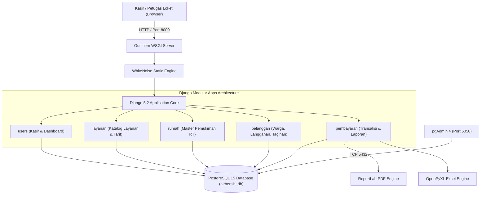
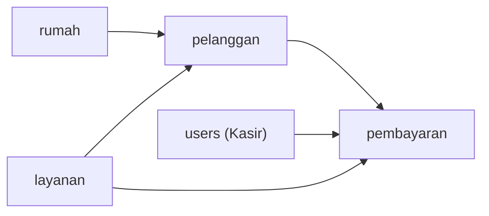

# Architecture Draft & System Blueprint

Dokumen ini menjelaskan rancangan arsitektur sistem tingkat tinggi, diagram ketergantungan Django App, dan aliran data transaksi pada proyek **WaterPay / AirBersih**.

---

## 🏗️ Gambaran Umum Sistem & Topologi Layanan

Aplikasi WaterPay berjalan dalam lingkungan terkontainerisasi menggunakan Docker Compose yang terdiri dari web server Django, database PostgreSQL, dan panel manajemen database pgAdmin 4.

---

## 📦 Peta Ketergantungan Django Apps (App Dependency Graph)

1. **`rumah`**: Menyediakan data unit properti hunian warga (`Rumah`). Menjadi fondasi penetapan alamat pelanggan.
2. **`layanan`**: Menyediakan katalog utilitas (`Layanan`) dan paket biaya bulanan (`JenisLayanan`).
3. **`pelanggan`**: Menghubungkan warga ke unit `Rumah`, mengikat paket `Langganan`, dan menerbitkan jadwal `Tagihan`.
4. **`users`**: Mengelola akun staf `Kasir` dan menyajikan rangkuman metrik pendapatan di dashboard.
5. **`pembayaran`**: Mencatat pembayaran tagihan yang dilayani oleh staf `Kasir`, mencatat stempel waktu, dan menyusun laporan cetak matriks PDF / Excel.

---

## 🛠️ Tumpukan Teknologi (Technology Stack)

| Komponen | Spesifikasi / Library | Peran Utama |
|---|---|---|
| **Language** | Python 3.11.7 | Bahasa pemrograman inti (sesuai `runtime.txt`) |
| **Framework** | Django 5.2.5 | Web framework backend & ORM |
| **Database** | PostgreSQL 15 | Sistem basis data relasional utama |
| **WSGI Server** | Gunicorn 23.0.0 | HTTP WSGI server produksi berkinerja tinggi |
| **Static Engine** | WhiteNoise 6.11.0 | Melayani & mengompresi file statis langsung di web server |
| **PDF Engine** | ReportLab 4.4.3 & WeasyPrint | Penyusunan laporan rekapitulasi matriks A4 |
| **Excel Engine** | OpenPyXL 3.1.5 | Penyusunan spreadsheet transaksi kasir |
| **Admin UI** | django-jazzmin 3.0.1 | Antarmuka panel admin Django yang modern |
| **DB Admin** | pgAdmin 4 | Monitoring visual dan kueri SQL kontainer PostgreSQL |

---

## 🌊 Aliran Data Transaksi Pembayaran Loket (Payment Lifecycle)

1. **Permintaan Pembayaran:** Kasir memasukkan nomor rumah / memilih nama pelanggan di Dashboard atau form pembayaran.
2. **Validasi Tagihan:** Selector memeriksa keberadaan tagihan aktif pada bulan dan tahun terpilih (`StatusChoice.Belum`).
3. **Eksekusi Transaksi Atomic (`@transaction.atomic`):**
   - Tagihan diubah statusnya menjadi `StatusChoice.Lunas`.
   - Record `Pembayaran` baru dibuat dengan mencatat ID kasir yang bertugas, tanggal transaksi, dan tarif paket.
4. **Respon:** Kasir menerima konfirmasi visual instan, saldo ringkasan dashboard terbarui secara otomatis.
