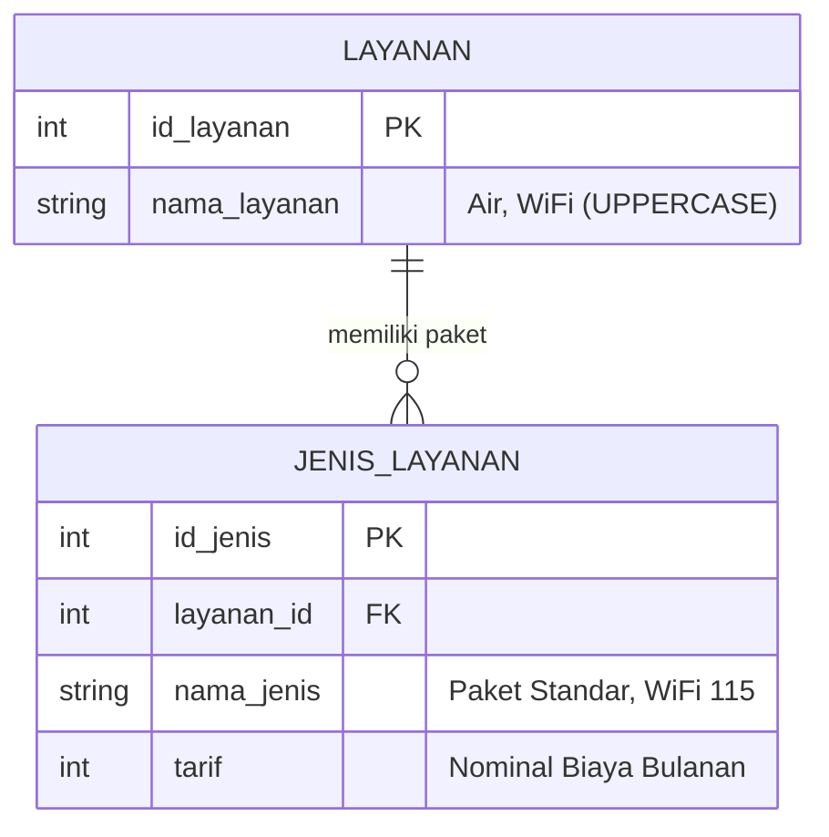

# Modul Layanan (Katalog Layanan & Tarif)

Modul `layanan` mengelola data master kategori layanan utilitas (seperti Air Bersih, WiFi) serta rincian paket dan tarif biaya bulanan.

---

## 🎯 Lingkup & Tujuan Domain
1. **Kategori Layanan Induk (`Layanan`):** Pengelompokan jenis layanan utilitas (misal: "AIR", "WIFI").
2. **Paket & Tarif Bulanan (`JenisLayanan`):** Rincian varian paket layanan dengan penetapan tarif nominal rupiah tetap (`tarif`).
3. **Integritas Penamaan:** Validasi otomatis huruf kapital (*uppercase*) dan pencegahan duplikasi nama layanan (*case-insensitive unique validation*).

---

## 🗄️ Relasi Model Database

---

## 🔒 Aturan Domain & Validasi Model

1. **Format Nama Layanan Standar:**
   - Nama layanan otomatis dikonversi ke huruf kapital pada `save()` (`self.nama_layanan.upper()`).
2. **Pencegahan Nama Duplikat:**
   - Metode `clean()` pada model `Layanan` memverifikasi tidak ada nama serupa (misal: "air" dan "Air" ditolak jika "AIR" sudah terdaftar).
3. **Integritas Penghapusan (Cascading):**
   - Menghapus entitas `Layanan` akan menghapus seluruh `JenisLayanan` di bawahnya (`on_delete=models.CASCADE`). Namun relasi dari modul `pelanggan` dan `pembayaran` dilindungi agar histori transaksi warga tidak hilang.

---

## 🧩 Lapisan Arsitektur & Antarmuka

- **Views:** Menggunakan Django Class-Based Views standar (`DaftarLayanan`, `TambahLayanan`, `UpdateLayanan`, `hapus_layanan`, `DaftarJenisLayanan`, `TambahJenisLayanan`, `UpdateJenisLayanan`).
- **Endpoint Data AJAX:** Digunakan oleh formulir pendaftaran langganan pelanggan dan transaksi kasir untuk memuat tarif paket secara dinamis.
