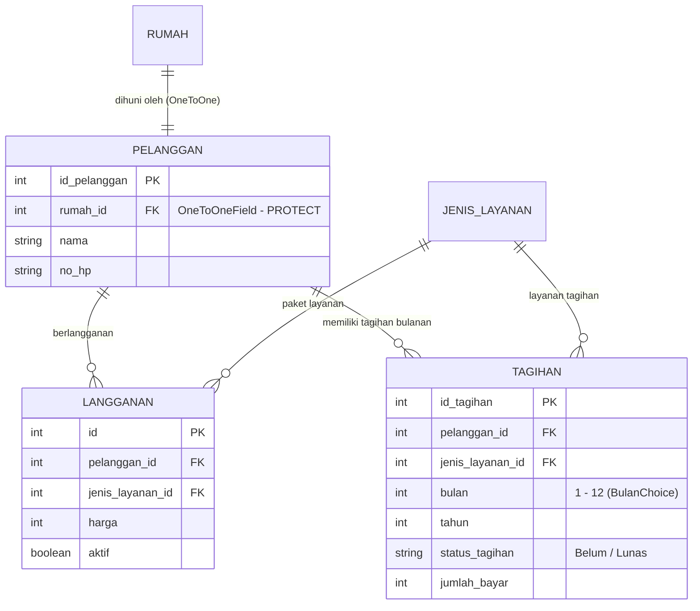

# Modul Pelanggan (Warga, Langganan & Tagihan)

Modul `pelanggan` mengelola entitas warga/konsumen, paket langganan aktif yang diambil warga, dan siklus penerbitan tagihan bulanan (*invoicing/billing*).

---

## 🎯 Lingkup & Tujuan Domain
1. **Identitas Pelanggan (`Pelanggan`):** Data diri warga (nama lengkap, kontak telepon/WhatsApp) yang terikat tepat pada satu unit `Rumah`.
2. **Paket Berlangganan (`Langganan`):** Pendaftaran layanan (Air, WiFi) yang dinikmati oleh pelanggan beserta status keaktifannya (`aktif = True/False`).
3. **Penerbitan Tagihan (`Tagihan`):** Catatan kewajiban pembayaran per periode (bulan & tahun) untuk tiap paket langganan pelanggan dengan status tagihan (`Belum` atau `Lunas`).
4. **Generator Tagihan Massal Tahunan:** Fitur otomatisasi pembuatan tagihan 12 bulan untuk seluruh pelanggan aktif dalam satu klik.

---

## 🗄️ Relasi Model Database



---

## 🔄 Generator Tagihan Tahunan (`generate_tagihan_setahun`)

Fungsi utilitas `generate_tagihan_setahun(tahun)` di [pelanggan/utils.py](file:///d:/Randi/water_pay/pelanggan/utils.py) mengeksekusi pembuatan tagihan tahunan:

```python
# Alur logika saat ini:
for bulan in range(1, 13):
    for langganan in Langganan.objects.filter(aktif=True):
        if not Tagihan.objects.filter(pelanggan=..., jenis_layanan=..., bulan=bulan, tahun=tahun).exists():
            Tagihan.objects.create(...)
```

### ⚠️ Isu Performa & Target Rekayasa
- Pada populasi pelanggan besar, iterasi 12 bulan x N pelanggan memicu ratusan kueri SQL sinkron yang lambat di web worker.
- **Rekomendasi:**
  1. Refaktor ke operasi bulk insert: `Tagihan.objects.bulk_create(...)`.
  2. Alihkan proses eksekusi ke antrean Celery worker via [ADR 0001](file:///d:/Randi/water_pay/docs/adr/0001-celery-async-tasks.md).

---

## 🧩 Lapisan Arsitektur Modul

- **Views:** Mengelola antarmuka tabel dan formulir pelanggan (`DaftarPelanggan`, `TambahPelanggan`, `UpdatePelanggan`), daftar paket (`DaftarLangganan`), dan penagihan (`DaftarTagihan`, `generate_tagihan`).
- **Validasi Alokasi Rumah:** Form pendaftaran pelanggan hanya menampilkan rumah yang belum memiliki penghuni (`penghuni__isnull=True`).
